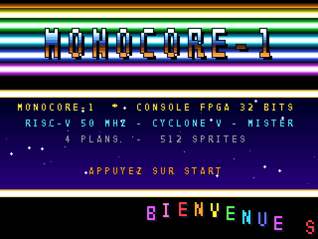

# Écran d'accueil (boot.rom)

L'écran que la console affiche au démarrage, façon intro de démo Amiga : barres « copper »,
logo chromé, ciel dégradé par effets raster, champ d'étoiles, texte défilant sinusoïdal et
musique. Il est écrit avec le SDK bas niveau `mc` (`sdk/SDK_MC.md`).



```sh
cd examples/boot
python3 ../../sdk/build.py .        # -> build/boot.mnc
```

Sur le MiSTer, copie `build/boot.mnc` sous le nom **`boot.rom`** dans `games/MONOCORE` : MiSTer
le charge tout seul au lancement du core. Pour qu'il apparaisse aussi dans le menu F12, garde une
copie en `.mnc`. `make_assets.py` régénère `sheet.png` (logo, étoiles, police) et `copper.png`
si l'on change le texte du logo.

Pour l'instant, START affiche « INSÉREZ UNE CARTOUCHE » : ce sera l'emplacement du lecteur de
cartouche (Flash SPI sur le port USER) quand il existera.
