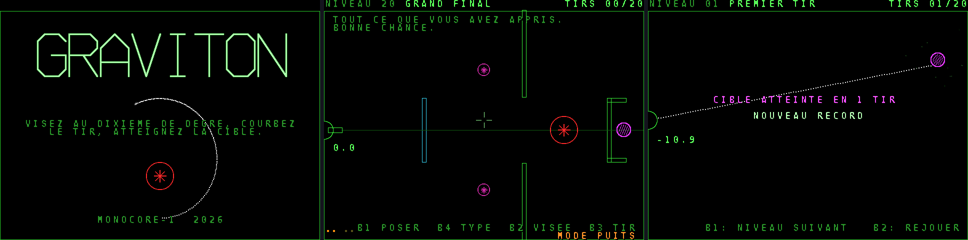

# GRAVITON — casse-tête gravitationnel

Un canon, plaqué contre le bord du cadre, tire un projectile qui doit atteindre la cible violette
qui tourne. Des **puits** courbent sa trajectoire. La forme dit le sens : un astérisque à huit branches attire,
une croix de quatre flèches tournées vers l'extérieur repousse. La taille dit la force : le rayon du
dessin croît comme la racine carrée de la puissance (six tailles), si bien qu'un puits deux fois
plus fort se voit nettement plus gros. La couleur dit qui l'a mis : rouge (ou violet pour un
repoussoir) s'il est fixé par le niveau, orange ou jaune si c'est le joueur qui le pose. Le tir est perdu s'il touche un mur vert, tombe dans un
puits, sort du cadre ou erre trop longtemps ; les murs bleus le font rebondir. Rien ne se pose dans
les zones hachurées, mais un puits peut aller jusque dans un mur.

Chaque tir laisse une trace en pointillés (les trois derniers restent, du plus clair au plus
sombre) : on corrige l'angle d'un dixième de degré et on recommence. Il y a 20 tirs par série ;
une fois épuisés, une nouvelle série commence, les puits posés restant en place.

Le jeu s'affiche en **640 × 480 entrelacé** (haute résolution du matériel version 5) : le monde
du jeu fait 320 × 240, mais tout est dessiné deux fois plus fin (traits d'un pixel, police vectorielle
anticrénelée en 16 × 16 comme dans SOLFEGE, sprites dessinés au double).

Style d'écran vectoriel monochrome à la manière des jeux Flash de tir gravitationnel des années
2000 ; nom, niveaux, graphismes et sons sont originaux.



## Commandes

| Manette | Clavier | Souris | Action |
|---|---|---|---|
| haut / bas (ou gauche / droite) | flèches haut / bas | molette | orienter le canon : 0,1° par appui, de plus en plus vite si on maintient |
| B3 | Espace | bouton du milieu | tirer ; pendant le vol, maintenu : accéléré |
| B2 | Retour arrière | | niveaux 13 à 20 : passer du mode VISEE au mode PUITS et inversement |
| croix (mode PUITS) | | déplacement | curseur |
| B1 (mode PUITS) | Entrée | bouton gauche | poser un puits, prendre ou reposer un puits déjà posé |
| B5 (mode PUITS) | | bouton droit | retirer le puits survolé |
| B4 (mode PUITS) | | | changer de type (attire / repousse) |
| B2 pendant le vol | | | abandonner le tir |
| START ou B6 | Échap | | menu : continuer, recommencer, choix du niveau, quitter vers le titre |

Dans le simulateur (`dist/monocore.html`), les touches du PC sont par défaut la manette du
joueur 1 : flèches = croix, Z X C = B1 B2 B3 (**C tire**), A S D = B4 B5 B6, Entrée ou 1 = START.
La colonne « Clavier » ci-dessus (Espace pour tirer, Entrée, Retour arrière, Échap) ne vaut que
si « clavier de la console » est coché (F9) ; les flèches visent alors en mode VISEE et déplacent
le curseur en mode PUITS.

Toutes les manettes sont lues : n'importe quel joueur de la borne peut jouer. Les puits qui restent
à poser sont les points en bas à gauche ; la ligne du bas rappelle les boutons utiles.

## Niveaux

20 niveaux, débloqués l'un après l'autre. De 1 à 12, on ne fait que viser, entre des puits fixes :
PREMIER TIR, UNE ETOILE, PAR-DESSUS, LA FENETRE, REBOND, DEUX ETOILES, L'ASTRE, LA COUPE,
LA FRONDE, CHAMP D'ETOILES, LE COUDE, LE CHAS. De 13 à 20, on pose aussi ses puits : A VOUS DE
POSER, DEMI-TOUR, ZONE INTERDITE, LE COULOIR, LE COFFRE, TROU NOIR, LE LACET, GRAND FINAL.
La progression et le record de chaque niveau (le moins de tirs) sont gardés en NVRAM
(`saves/MONOCORE/graviton.sav` sur MiSTer, à l'ouverture de l'OSD).

## Rejouer un niveau

START (ou B6, si START est pris par la MiSTer) ouvre à tout moment le menu ; « CHOIX DU NIVEAU »
ramène à la liste, où l'on peut reprendre n'importe quel niveau déjà ouvert. Les niveaux gagnés y
sont en vert, avec le record (le moins de tirs).

## Construire ses niveaux

La dernière ligne de la liste, CONSTRUIRE UN NIVEAU, mène à six emplacements (MON NIVEAU 1 à 6),
enregistrés en NVRAM à chaque modification. B1 construit l'emplacement choisi, B3 le joue.

| Manette | Souris | Action |
|---|---|---|
| croix | déplacement | curseur (les objets se calent sur une grille de 4 pixels) |
| B4 / B5 | molette | outil précédent / suivant : CANON, CIBLE, MUR, MUR REBONDISSANT, PUITS, GROS PUITS, REPOUSSOIR, PUITS A POSER |
| B1 | bouton gauche | appliquer l'outil : placer le canon (collé au bord le plus proche s'il en est à moins de 16 pixels) ou la cible, début puis fin d'un mur, poser un puits ; avec PUITS A POSER, un puits orange de plus à donner au joueur (0 à 4) |
| B2 | bouton droit | effacer le puits ou le mur le plus proche ; pendant un mur, l'annuler ; avec PUITS A POSER, un puits jaune de plus (0 à 3) |
| B3 | bouton du milieu | essayer le niveau tout de suite (START ou B6 ramène à la construction) |
| START ou B6 | | menu : continuer, essayer, tout effacer, quitter |

La plage d'angles du canon suit le bord où il est collé (comme dans la campagne) ; loin des bords,
il tourne sur 360°. Un niveau construit compte 24 murs et 10 puits fixes au plus.

## Fichiers

| Fichier | Contenu |
|---|---|
| `physics.h` | la physique, en entiers seulement (angle au dixième de degré, virgule fixe 16.16, 4 sous-pas par image, attraction en 1/r² adoucie sous 6 px, murs, rebonds, règles de pose) ; aucune division 64 bits |
| `sintab.h` | table de sinus (quart de tour, 1024 pas par tour) |
| `levels.h` | les niveaux (canon, plage d'angles, vitesse, cible, puits à poser, puits fixes, murs, zones interdites) |
| `main.c` | le jeu : deux plans « bitmap » de 640 × 480 en tuiles 16 × 16 allouées à la demande dans une réserve de 832 tuiles (l'écran est noir à plus de 90 % ; les tuiles vidées retournent à la réserve, les zones hachurées partagent une seule tuile), police 16 × 16 anticrénelée (`font16.h`), sprites générés au démarrage, titre en lettres vectorielles, sons PSG |
| `make_font.py` | fabrique `font16.h` : DejaVu Sans Mono Bold rendue en 16 × 16 avec 4 niveaux de couverture (indices 1 à 4), que les palettes d'encre mélangent au fond noir |
| `tools/clear.c` | niveaux de visée : pour chaque angle gagnant, à quelle distance le tir passe du puits le plus proche (une solution qui frôle un puits est injouable) |
| `tools/aim.c` | niveaux de visée : essaie tous les angles au dixième de degré, compte ceux qui touchent (la tolérance du niveau) |
| `tools/tune.c` | règle les puits fixes d'un niveau de visée jusqu'à obtenir quelques angles gagnants |
| `tools/solve.c` | niveaux à poser : tirages au hasard (mesure de difficulté) puis optimisation locale (preuve qu'une solution existe) |
| `tools/brute.c` | niveaux à un seul puits : toutes les positions (grille de 4 px) et tous les angles |
| `tools/draw.py` | planche PNG des niveaux avec la trajectoire trouvée par `solve` |

`physics.h` est compilé tel quel par le jeu (RV32IM) et par `solve` (PC) : une solution trouvée
sur PC se rejoue à l'identique sur la console.

## Construire et vérifier

```sh
python3 ../../sdk/build.py .                    # -> build/graviton.mnc
cd tools && cc -O2 -o aim aim.c -lm && cc -O2 -o solve solve.c && cc -O2 -o brute brute.c
./aim                                            # niveaux 1-12 : angles gagnants de chaque niveau
./brute 12                                       # niveau 13 : positions du puits qui mènent à la cible
./solve 19 10 dump 100 7 3                       # niveau 20 : graine 7, à partir de 3 puits
python3 draw.py /tmp/levels.png                  # planche des niveaux et des solutions trouvées
```

Arguments de `solve` : niveau (0 = premier, -1 = tous), tirages au hasard, `dump` pour écrire les
trajectoires (`/tmp/lvNN.txt`, lues par `draw.py`), redémarrages de l'optimisation, graine, nombre
minimal de puits essayés. Pour une version de test qui commence à un niveau donné, tous niveaux
ouverts : `cflags = -DSTART_LEVEL=n` dans `project.txt`.
