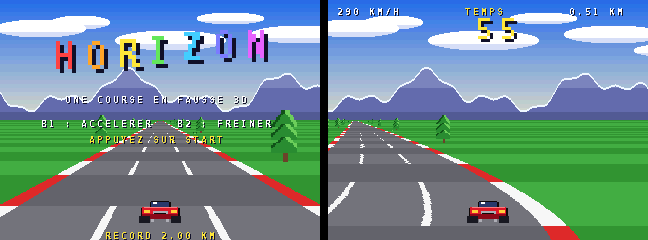

# HORIZON — course en fausse 3D (SDK « mc »)

Une course contre la montre dans l'esprit d'OutRun et de Pole Position : une route qui serpente
jusqu'à l'horizon, des bandes qui défilent, des arbres et des panneaux qui grossissent en
approchant, des voitures à doubler. Les points de contrôle, tous les 150 segments de route,
ajoutent 25 secondes. Tout est **calculé au démarrage**, sans aucun fichier image ni son.



## Compiler et jouer

```sh
cd examples/horizon
python3 ../../sdk/build.py .        # -> build/horizon.mnc
```

Une version déjà compilée est fournie dans `build/horizon.mnc`. Bouton 1 : accélérer ;
bouton 2 ou bas : freiner ; gauche et droite : tourner ; START : départ.

## Comment la route est dessinée

La console n'a pas de matériel 3D, mais elle sait décaler chaque ligne d'un plan, à
l'horizontale (`dx`) comme à la verticale (`dy`). Toute la route repose là-dessus :

1. **Une texture de route** sur le plan 2 : 120 lignes, la ligne *r* étant une route droite vue
   à la profondeur de la ligne d'écran 120 + *r* (sa largeur grandit avec *r*). Elle est stockée
   deux fois, une fois avec la palette claire et une fois avec la palette sombre. Les deux
   copies ont exactement les mêmes tuiles : seule la palette de la carte change (168 tuiles en
   tout pour une texture de 1024 × 240 pixels).
2. **Pour chaque ligne de l'écran**, `dy` choisit la ligne de texture qui a la bonne largeur,
   dans la copie claire ou sombre selon la distance de cette ligne, d'où les bandes qui
   défilent. `dx` décale la ligne pour suivre les virages et la position de la voiture.
3. **Les virages** s'obtiennent en intégrant la courbure du circuit ligne par ligne, du bas de
   l'écran vers l'horizon : chaque ligne ajoute la courbure du segment qu'elle montre à une
   pente, et cette pente à un décalage (`draw_road`).
4. **Les objets** (arbres, buissons, panneaux, voitures) sont des sprites. Leur profondeur donne
   la ligne d'écran où ils touchent le sol, et donc leur zoom et leur position latérale. Ils sont
   triés du plus proche au plus lointain avec `qsort`, pour que les plus proches passent devant.

| Technique | Où | Fonctions du SDK |
|---|---|---|
| Route : choix de ligne et décalage, ligne par ligne | `draw_road` | `mc_layer_linescroll`, `mc_linescroll` |
| Texture de route, montagnes et nuages calculés, tuiles partagées | `build_layer`, `road_pixel` | `mc_chr_upload`, `mc_tilemap_load`, `calloc` |
| Sprites dessinés par le programme (voiture, arbre, buisson, panneau) | `make_sprites` | `mc_chr_upload`, `MC_CHR` |
| Objets et voitures zoomés selon leur distance, triés par profondeur | `draw_world` | `mc_sprite_zoom`, `mc_sprite_flip`, `qsort` |
| Ciel dégradé : 30 effets raster | `sky` | `mc_raster_add` |
| Montagnes et nuages qui glissent dans les virages (parallaxe) | `scroll_scenery` | `mc_layer_scroll` |
| Compte à rebours en chiffres agrandis 3 fois | `hud` | `mc_sprite_zoom` |
| Moteur (dent de scie dont la hauteur suit la vitesse), crissements, musique | `engine_sound`, `music` | `mc_psg`, `mc_tune` |

## Pistes pour aller plus loin

- des **bosses** : faire varier aussi la hauteur de l'horizon ligne par ligne (`dy`) ;
- un **tunnel** ou une **ville** : d'autres palettes de route et d'autres objets sur certains segments ;
- un **embranchement** en fin d'étape, comme dans OutRun ;
- un **rétroviseur** de score en ligne, ou deux joueurs en écran partagé (raster au milieu de l'écran).
