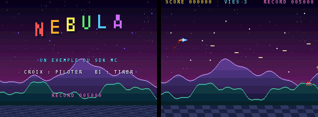

# NEBULA — exemple complet du SDK « mc »

Un petit shoot'em up horizontal : on pilote un vaisseau à travers trois plans de décor, on abat
des vagues de soucoupes et des orbes qui visent le joueur. Il sert de démonstration du SDK bas
niveau `mc` (voir `sdk/SDK_MC.md`) : tout ce qu'il affiche est **calculé au démarrage**, sans
aucun fichier image ni son.



## Compiler et jouer

```sh
cd examples/nebula
python3 ../../sdk/build.py .        # -> build/nebula.mnc
```

Glisse `build/nebula.mnc` sur le simulateur (`dist/monocore.html`), ou copie-le dans
`games/MONOCORE` sur la carte SD du MiSTer. Croix : piloter ; bouton 1 : tirer ; START : jouer.

## Ce que l'exemple montre

| Technique | Où | Fonctions du SDK |
|---|---|---|
| Sprites dessinés en « ASCII art » et convertis en cellules 4 bpp au démarrage | `pack_art`, `make_sprites` | `mc_chr_upload`, `mc_sprite_sheet` |
| Décors procéduraux : une fonction couleur(x, y) découpée en tuiles 8 × 8, tuiles identiques partagées (hachage puis comparaison) | `build_layer` | `calloc`, `free`, `mc_chr_upload`, `mc_tilemap_load` |
| Parallaxe sur trois plans (étoiles, montagnes, collines) | `scroll_backgrounds` | `mc_layer_scroll` |
| Sol en perspective : décalage différent sur chacune des 24 dernières lignes | `scroll_backgrounds` | `mc_layer_linescroll`, `mc_linescroll` |
| Ciel dégradé : 54 effets raster, un toutes les 4 lignes | `sky` | `mc_raster_add`, `mc_raster_line` |
| Jusqu'à 233 sprites par image (tirs, ennemis, 160 particules) | `play_frame`, `update_fx` | `mc_sprite`, `mc_sprites_used`, `mc_frame` |
| Lettres du titre et particules agrandies par le zoom des sprites | `title_screen`, `update_fx` | `mc_sprite_zoom` |
| Tirs ennemis dirigés vers le joueur | `fire_at_player` | `mc_atan2`, `mc_cos`, `mc_sin` |
| Score affiché avec `snprintf`, record gardé en NVRAM | `hud`, `save_best` | `snprintf`, `MC_NVRAM` |
| Bruitages PSG (tir, explosions) et musique sur deux voies | `sfx_update`, `music` | `mc_psg`, `mc_tune` |

La priorité d'affichage repose sur la règle du matériel : le texte (plan 0, priorité 3) passe
devant les sprites (priorité 4), qui passent devant les collines (plan 3, priorité 2), devant les
montagnes (plan 1, priorité 1), devant les étoiles (plan 2, priorité 0).

## Pistes pour aller plus loin

- remplacer les décors calculés par des images converties (`maps = …` dans `project.txt`) ;
- ajouter des bonus, un boss à plusieurs sprites (un sprite peut mesurer jusqu'à 256 × 256) ;
- passer en 384 × 224 avec `mc_video_mode`, comme une borne d'arcade ;
- jouer les explosions en PCM (`sounds = boom.wav`, `mc_pcm_play`).
