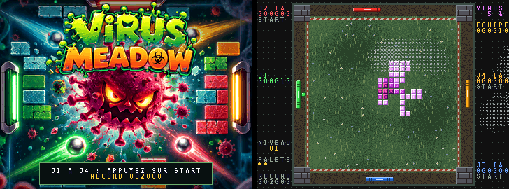

# VIRUS MEADOW — pong-casse-briques coopératif à 4 joueurs

Quatre raquettes gardent les quatre côtés d'une prairie carrée : J1 à gauche (vert), J2 en haut
(rouge), J3 en bas (bleu), J4 à droite (orange). Au centre, un virus s'étend brique par brique.
Un seul palet, qui prend la couleur du dernier joueur qui l'a touché, casse les briques.

- le virus touche la clôture : la prairie est perdue ;
- le palet sort : un palet perdu, le virus fait une poussée, le joueur qui l'a raté sert à nouveau ;
- toutes les briques détruites : niveau suivant (plus de colonies, croissance plus rapide).

Le cœur de chaque raquette bat (plus lentement et plus faiblement pour un joueur console) et
bondit quand elle frappe le palet. Le palet laisse une traînée de comète de sa couleur, posée le
long de sa trajectoire : chauffée à blanc près du palet, puis de sa couleur, puis sombre, elle
ondule comme une flamme et sème des braises ; plus le palet va vite, plus elle s'allonge et chauffe. L'intérieur des cellules est vivant : une
spore qui rampe dans les jeunes cellules, un anneau qui tourne autour d'un œil qui cligne dans les
cellules moyennes, un noyau hérissé qui bat comme un cœur dans les plus résistantes.

Les jeunes cellules (rose pâle) sont cassées au passage ; les plus anciennes (violettes) perdent un
niveau de résistance à chaque coup et font rebondir le palet.

## Mode MUTANT

À l'écran de sélection, un joueur inscrit change de mode avec le bouton 2 ou gauche / droite.
En mode MUTANT, chaque cellule du virus résiste à une couleur : elle prend exactement la couleur
d'une raquette (seul son noyau reste celui du virus et montre sa résistance), et le palet de cette
couleur (celle du dernier joueur qui l'a touché) rebondit dessus sans l'abîmer. Les colonies naissent en quatre plaques de couleur ; une nouvelle cellule
garde l'immunité de celle qui l'a produite, sauf mutation (une fois sur dix). Il faut donc se
passer le palet pour attaquer chaque plaque avec la bonne couleur. Chaque mode a son record.



## Démarrage

« LA PRAIRIE DU VIRUS POUSSE... » (au moins 3 s, le temps de produire les graphismes), puis un
fondu enchaîné vers « UN SEUL ESPOIR POUR LIMITER LA MALADIE » (le second texte est écrit sur le
plan 2, encore vide, pour que les deux textes se superposent), puis l'écran d'accueil, où la
musique démarre.

## Ambiance

Le nom vient de *Virus Meadow*, de And Also The Trees (1986) : la campagne anglaise, grise et
humide, vue par le post-punk. Le jeu en reprend l'atmosphère, sans rien emprunter à la chanson :

- la lumière baisse de niveau en niveau : après-midi couvert, crépuscule, nuit au clair de lune
  (puis le cycle recommence), avec un fondu pendant l'annonce du niveau ; seul le virus reste vif ;
- des bancs de brume dérivent sur la prairie (sprites tramés, qui laissent voir le jeu au travers) ;
- de temps en temps, un vol de corbeaux traverse le ciel, avec un croassement lointain ;
- la musique est une boucle originale de 48 s (`make_music.py`) : guitare claire en arpèges qui
  sonnent, mélodie jouée en trémolo, basse mélodique, toms roulants, orgue en bourdon et vent, le
  tout dans une grande réverbération. Elle est rendue deux fois et la seconde passe est gardée,
  pour que la boucle n'ait pas de raccord.

## Compiler et jouer

```sh
cd examples/virusmeadow
python3 make_music.py               # -> music_l.raw, music_r.raw (numpy, scipy)
python3 ../../sdk/build.py .        # -> build/virusmeadow.mnc
```

Une version déjà compilée est fournie dans `build/virusmeadow.mnc`.

START sur n'importe quelle manette : rejoindre (à l'écran de sélection ou en pleine partie), puis
pause. Les places libres sont jouées par la console. J1 et J4 : haut / bas ; J2 et J3 : gauche /
droite (croix, stick gauche, spinner ou paddle). Bouton 1 : servir. Sans action pendant 25 s sur
l'écran d'accueil, une démonstration à quatre joueurs console se lance (dans un mode, puis dans l'autre). Les records (un par mode) sont gardés en NVRAM.

## Ce que l'exemple montre

| Technique | Où | Fonctions du SDK |
|---|---|---|
| Écran d'accueil en image 8 bpp (256 couleurs, tuiles 16 × 16), fondu par la palette | `show_title_picture`, `title_colours` | clé `maps8`, `mc_layer`, `MC_8BPP` |
| Prairie procédurale en tuiles 8 × 8 avec partage des tuiles identiques, carte gardée pour revenir de l'écran d'accueil | `build_meadow`, `show_meadow` | `mc_chr_upload`, `mc_tilemap_load` |
| Virus sur un plan de tuiles, palette pulsante | `infect`, `heal`, `virus_colours` | `mc_tile`, `mc_color` |
| Cellules animées : les 12 tuiles du virus redessinées 10 fois par seconde en CHR RAM, sans toucher à la carte | `virus_brick`, `virus_animate` | `mc_chr_upload` |
| Traînée de comète : jusqu'à 12 sprites répartis le long de la trajectoire, braises | `draw_puck`, `ember` | `mc_sprite_zoom` |
| Cœur battant des raquettes (deux couleurs de leur palette animées) | `heart_level`, `heart_colours` | `mc_color` |
| Encarts sombres derrière le texte, sur un plan dédié | `panel` | `mc_layer` (plan 3) |
| Quatre joueurs, entrées numériques et analogiques | `control_human` | `mc_pad`, `mc_stick_x/y`, `mc_spinner_delta`, `mc_paddle` |
| Joueurs console | `control_ai` | — |
| Lumière par niveau (fondu entre deux palettes) | `meadow_light`, `set_mood` | `mc_color` |
| Brume en tramage ordonné, corbeaux | `make_atmosphere`, `atmosphere` | `mc_sprite`, `mc_sprite_flip` |
| Musique en boucle sur deux voix PCM 16 bits | `music_play` | `mc_pcm_play` |

L'image d'accueil (`title.png`) est tirée d'une jaquette générée par IA, recomposée en 368 × 272 et
réduite à 255 couleurs.
